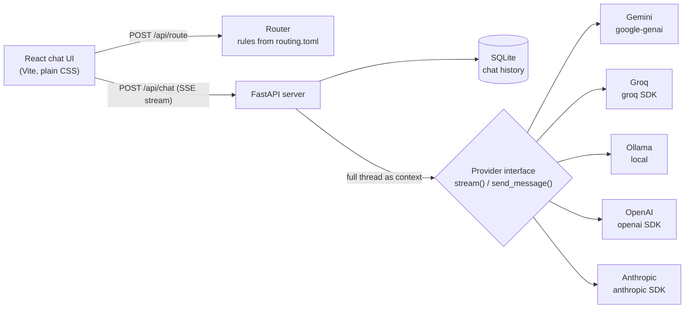

# AIRouter

A chat app that talks to each AI provider through its **own official API**, suggests which model fits your question (and says why), and lets you switch models in the middle of a conversation without losing context.

**Live demo: <https://omkar210404.github.io/AI-Router/>.** The router works live there: type any question and see which AI it picks and why. The chats in the sidebar were recorded from the real app. GitHub Pages has no server, so the demo doesn't call any AI; to chat for real, run it on your computer with your own keys (steps below).

- **Direct integrations, no aggregator.** Gemini (`google-genai`), Groq (`groq`), OpenAI (`openai`), Anthropic (`anthropic`) and Ollama (`ollama`), each through its own official SDK with its own key in `.env`.
- **Router.** Classifies each message (private, coding, math, creative, quick fact, long reasoning, image, general) with simple rules, picks the first configured model from an editable preference list, and shows the reason and the signals it matched. You can accept or override.
- **Switch models any time.** The new model receives the whole conversation so far. Every reply shows which model wrote it.
- **Works for free.** Gemini's and Groq's free tiers and/or a local Ollama model are enough. Paid providers are optional.
- **Private stays local.** Messages that mention things like bank details, salary, passwords or medical reports are routed to the local Ollama model, so they never leave your computer.


## Which AI does it pick?

In **Auto** mode the router sorts your message into a category, then walks that category's preference list and picks the **first model you have a key for**. So the answer depends on which keys you've added. This table comes from running the router on these exact questions:

| You ask | Category | Ollama only | Free setup (Gemini + Groq + Ollama) | All keys (+ OpenAI + Claude) |
|---|---|---|---|---|
| What is the capital of Japan? | Quick fact | llama3.2:3b (local) | Qwen3.8 27B (Groq) | Qwen3.8 27B (Groq) |
| Solve 3x + 7 = 22 for x | Math | llama3.2:3b (local) | GPT-OSS 120B (Groq) | GPT-5 |
| Write a Python function that checks if a number is prime | Coding | qwen2.5-coder:7b (local) | Gemini 3.5 Flash | Claude Sonnet 5.5 |
| Write a short poem about the monsoon | Creative writing | llama3.2:3b (local) | Gemini 3.5 Flash | Claude Sonnet 5.5 |
| Compare SQLite and PostgreSQL for a side project, step by step | Long reasoning | llama3.2:3b (local) | GPT-OSS 120B (Groq) | GPT-5 |
| Look at this screenshot and tell me what the error says | Image / vision | llama3.2:3b (local)\* | Gemini 3.5 Flash | Gemini 3.5 Flash |
| Keep this private: what should I ask my doctor about my blood pressure? | Private / personal | llama3.2:3b (local) | llama3.2:3b (local) | llama3.2:3b (local) |
| reasons for diabetes | General chat | llama3.2:3b (local) | Gemini 3.5 Flash | Gemini 3.5 Flash |

\* No vision model is set up, so the router falls back to any working model and says so.

How to read it:
- **Private questions always stay on your computer.** Words like *private, bank, salary, password, medical report* send the message to local Ollama, even when cloud keys are set.
- **Quick facts go to the fastest model**, and math and step-by-step questions go to a reasoning model.
- Click **Why?** above the text box to see the category, the reason and the exact words that matched. Use the dropdown next to it to pick a different model before sending.
- The choices live in [routing.toml](routing.toml), and you can change them (see [Customising the router](#customising-the-router)).

## Screenshots

| Switching models mid-thread | Settings: providers and routing rules |
|---|---|
|  |  |


All screenshots are of the real app. The switching example goes Gemini 3.5 Flash → local Llama 3.2 3B → Gemini 3.5 Flash-Lite in one thread; the other replies come from local Ollama models.

## How it works



- **Provider interface** ([airouter/providers/base.py](airouter/providers/base.py)): every provider implements `stream(model, messages)` (yields tokens, then token usage if the provider reports it), `send_message()` and `list_models()`. If a key is missing the provider raises `NotConfigured`; it never fakes a reply.
- **Context on switch**: each request rebuilds the thread from SQLite as a plain `role/content` list, so whichever model answers next sees everything, including replies written by other models.
- **Router** ([airouter/router.py](airouter/router.py) + [routing.toml](routing.toml)): each category has keywords, regex patterns, weights and optional length bonuses. Highest score wins; nothing matched means "general". The router then walks the category's `prefer` list and picks the first model you have configured. If the top choice isn't set up, it says so ("Claude Sonnet 5.5 would be first choice but isn't configured"). The file is re-read on every request, so edits apply immediately.
- **Streaming**: the server sends Server-Sent Events (`meta`, `token`, `done`, `error`). Each saved reply stores total time, time to first token and the provider's token counts. If you press stop, the partial reply is kept and marked as stopped.

## Run it on your computer

You need **Python 3.11+**, **Node 18+** and at least one of: a free Gemini key, a free Groq key, or Ollama installed.

### Step 1: Download and install

```bash
git clone https://github.com/Omkar210404/AI-Router.git
cd AI-Router

python -m venv .venv
.venv\Scriptsctivate            # macOS/Linux: source .venv/bin/activate
pip install -r requirements.txt

cd web
npm install
npm run build
cd ..
```

### Step 2: Create your `.env` file

```bash
copy .env.example .env            # macOS/Linux: cp .env.example .env
```

Open `.env` in any text editor. It has one line per provider. Fill in only the ones you want and leave the rest empty. A provider with no key shows as "not configured" in the app and is never called.

### Step 3: Add your own API keys

| Provider | Cost | Where to get a key | Line in `.env` |
|---|---|---|---|
| Google Gemini | Free tier (rate limited) | <https://aistudio.google.com/apikey> | `GEMINI_API_KEY=` |
| Groq | Free tier (rate limited) | <https://console.groq.com/keys> | `GROQ_API_KEY=` |
| Ollama | Free, runs on your computer | No key: install from <https://ollama.com> | (none) |
| OpenAI | **Paid** | <https://platform.openai.com/api-keys> | `OPENAI_API_KEY=` |
| Anthropic (Claude) | **Paid** | <https://console.anthropic.com/settings/keys> | `ANTHROPIC_API_KEY=` |

**Gemini (free):**
1. Open <https://aistudio.google.com/apikey> and sign in with a Google account.
2. Click **Create API key** and copy it.
3. Paste it after `GEMINI_API_KEY=` in `.env` (no spaces, no quotes) and save.

**Groq (free):**
1. Open <https://console.groq.com/keys> and sign in (a Google account works).
2. Click **Create API Key** and copy it. It starts with `gsk_`.
3. Paste it after `GROQ_API_KEY=` in `.env` and save.

**Ollama (free, local, nothing leaves your computer):**
1. Install Ollama from <https://ollama.com> and make sure it is running.
2. Download a model, for example `ollama pull llama3.2:3b` (about 2 GB, general questions) and/or `ollama pull qwen2.5-coder:7b` (about 4.7 GB, coding).
3. No key needed. Every model you pull shows up in the picker by itself. Local models need free RAM; on a 16 GB laptop, close heavy apps first.

**OpenAI or Claude (paid, optional):**
1. Create an account on the provider's site (links above), add a payment method or buy credits, then create an API key. A ChatGPT or Claude chat subscription does **not** include API access.
2. Paste the key after `OPENAI_API_KEY=` or `ANTHROPIC_API_KEY=` and save.
3. Every message you send to these models is billed to your account. The app marks them with a **paid** tag.

Keep your keys safe: `.env` is listed in `.gitignore`, so git never uploads it. Never paste a key into code, a screenshot or a public page. If a key leaks, delete it on the provider's site and create a new one.

### Step 4: Start the app

```bash
python -m airouter serve          # opens http://127.0.0.1:8400
```

Go to **Settings** and click **Test connection** on each provider. This only lists the provider's models, which costs nothing. A green "Working" means your key is fine. If you change `.env` later, stop the app (Ctrl+C) and start it again.

For frontend development, run `npm run dev` in `web/` (proxies `/api` to port 8400) alongside `python -m airouter serve --no-browser`.

## Self-test

`python -m airouter selftest` needs no keys and no network. It runs the router on 14 sample queries, exercises the provider interface with a mock provider, checks that providers without keys refuse to answer, and runs a two-turn chat through the real HTTP endpoint (switching models between turns) before reloading it from SQLite. Output from this repo:

```
PASS  router classifies sample queries: 14/14 sample queries routed as expected; fallbacks explained
PASS  provider interface (mock): stream yields tokens then usage; send_message joins them
PASS  unconfigured provider is honest: gemini/groq/openai/anthropic without keys -> 'not configured', no reply produced
PASS  history save/resume + model switch: 2 turns saved, model b got model a's context, thread resumes from DB

4/4 steps passed
```

`pytest` runs the same checks plus one for context building (5 tests, all passing).

## What was tested live

- **Gemini (free tier)**: real streaming chats with `gemini-3.5-flash` and `gemini-3.5-flash-lite` (about 2.5-6 s per short reply), including a Gemini → Ollama → Gemini switch in one thread where each model answered from the earlier turns. On a free key, the older `gemini-2.5-*` models returned "no longer available" and `gemini-3.1-pro-preview` returned "quota exceeded", so Pro is labelled paid and left out of the router's picks.
- **Ollama**: real streaming chats with `llama3.2:3b`, `qwen2.5-coder:7b` and `qwen2.5-coder-16k`. On this machine (Ryzen 5 laptop, 16 GB RAM), warm replies took about 5-17 s and the first reply after loading a model took 20-35 s. Once, with under 2 GB of RAM free, loading the model took over half an hour, so local models need free memory.
- **Groq (free tier)**: real chats with `qwen/qwen3.8-27b`, `openai/gpt-oss-20b` and `openai/gpt-oss-120b`, about 1-2.5 s per short reply. The Llama models Groq used to host were no longer listed for this key.
- **Auto mode across providers**: in one live run the router sent a quick fact to Qwen on Groq (1.2 s), an equation to GPT-OSS 120B on Groq (1.5 s), a poem and a general question to Gemini 3.5 Flash (8-15 s) and a salary/budget question to local Llama. One Gemini request failed with a temporary `503 UNAVAILABLE` (model overloaded); the app shows the error and a *Try again* button rather than a made-up answer.
- **OpenAI, Anthropic**: the modules are written against each official SDK and tested for the "not configured" path, but have not been run with real keys, to avoid spending money. Model names in `routing.toml` (e.g. `gpt-5`, `claude-sonnet-5-5`) may need updating as providers release new ones; *Test connection* shows the models your key can see.

## Customising the router

Open [routing.toml](routing.toml). For example, to send coding questions to a local model first:

```toml
[categories.coding]
prefer = ["ollama:*coder*", "anthropic:claude-sonnet-5-5", "gemini:gemini-3.5-flash"]
```

To keep an installed Ollama model out of the picker (without uninstalling it), add it to `hide` under `[ollama]` in the same file.

The default preferences reflect common opinion about each model family, **not benchmarks I ran**. Change them to match your own experience.

## Limitations

- The router is keyword/regex rules, not a trained model. It handles clear-cut messages well and gets mixed ones wrong (a message mentioning both "error" and "screenshot" depends on weights).
- No image upload yet. The router can recognise an image question and suggest a vision-capable model, but you have to describe the image in text.
- No cost estimates in money: prices change often, so the app shows the provider's token counts and labels paid models instead.
- Single user, local only. There is no login; don't expose the server to a network.
- Long threads are sent in full every time. There is no trimming, so very long chats can hit a model's context limit.

## Project layout

```
airouter/
  providers/       base.py (interface), gemini.py, groq.py, ollama.py, openai.py, anthropic.py
  router.py        rule-based classifier + model pick
  server.py        FastAPI: models, providers, route, chat (SSE), history
  db.py            SQLite history
  selftest.py      offline checks (mock provider)
routing.toml       model catalog + routing rules (edit me)
web/src/           React UI: App, Chat, Settings, ui helpers, styles.css
tests/             pytest
```

## License

MIT
